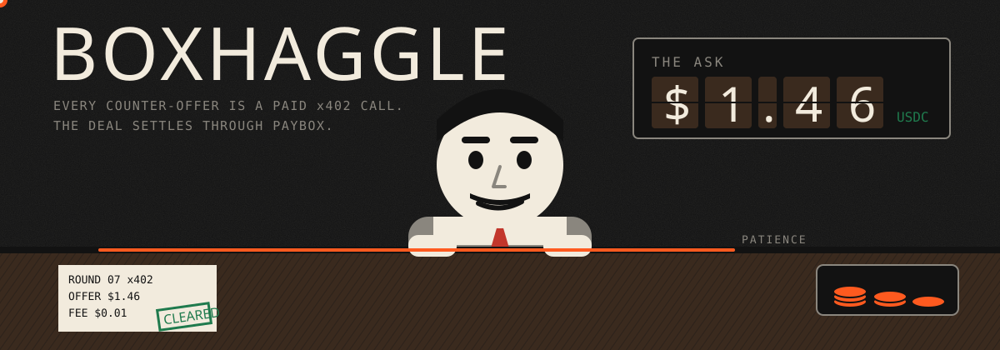
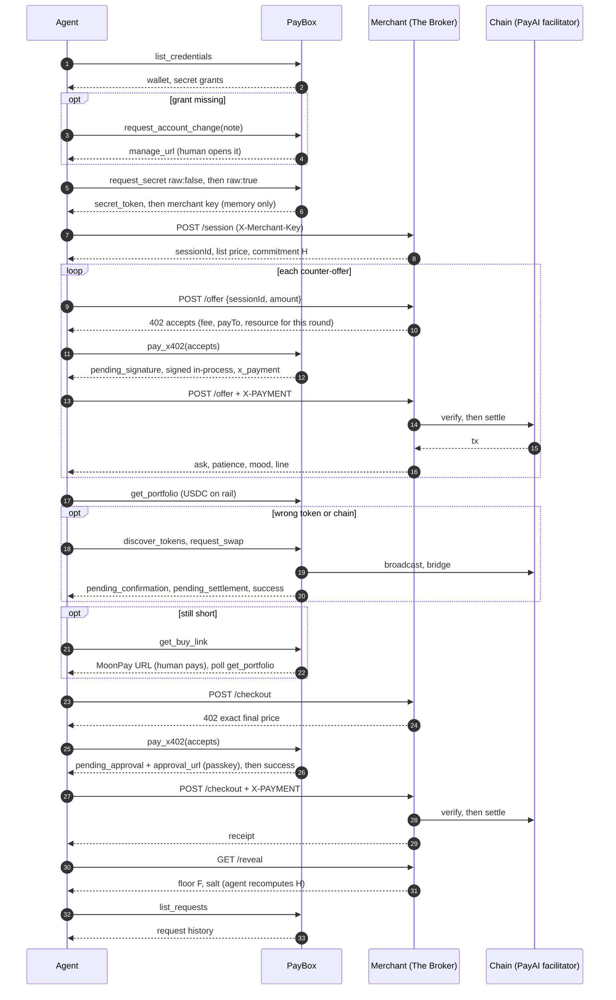
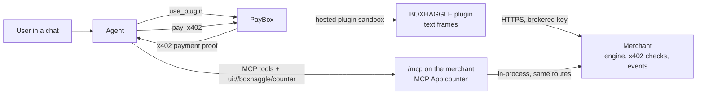

<p align="center">
  
</p>

# BOXHAGGLE

An AI agent haggles with **The Broker**, a merchant bot with a hidden floor price, a patience meter and a mood. Every counter-offer is a paid x402 micro-call. The final purchase settles through PayBox. The agent never holds a raw wallet key or card number, and the merchant key it uses comes out of the PayBox vault.

Built for the PayBox (MoonPay) Chapter 1 hackathon: a working PayBox marketplace plugin, end to end.

**Proof:** the first real haggle, five paid offers and a 1.28 USDC checkout on Solana mainnet with every signature and a verified reveal, is in [`docs/PROOF.md`](docs/PROOF.md).

## Demo

<!--
  TODO(demo-video): upload the demo video here.
  1. Edit this README on github.com (pencil icon) on the default branch.
  2. Drag the .mp4 into the editor on the empty line below this comment.
     GitHub uploads it and inserts a https://github.com/user-attachments/assets/... link,
     which renders as an inline player.
  3. Commit. Keep the file under 100 MB.
-->

_Demo video: coming soon. The spectator UI's Replay mode plays the full flow without spending anything._

## The game in one paragraph

The agent picks an item. The Broker publishes a SHA-256 commitment to a secret floor price before the first offer. Each counter-offer costs a small x402 fee (default 0.01 USDC). Near offers make The Broker shave the ask; lowballs burn the patience fuse; an empty fuse means The Broker walks and the fees are gone. When The Broker says sold, the agent pays the exact price through PayBox (passkey approval if above the user's threshold), then the floor and salt are revealed and anyone can recompute the hash. Lowest total cost wins.

## PayBox surface, mapped to game beats

| Game beat | PayBox tool | How BOXHAGGLE calls it | What the agent receives |
| --- | --- | --- | --- |
| Check the vault | `list_credentials` | `PayboxClient.listCredentials()` | Wallet, card and secret grants, safe metadata only |
| Missing grant | `request_account_change` | `requestAccountChange(note)` | A `manage_url` for the human |
| Fetch the merchant key | `request_secret` | `requestSecret({ raw: false })`, then `raw: true` (see security model) | A one-time `secret_token`, then the key in memory |
| Every counter-offer | `pay_x402` | `payX402({ accepts, resourceUrl })`, header mode, signed in-process | `output.value.x_payment`, replayed as `X-PAYMENT` |
| Watch a pending request | `get_request` | SDK wait plus observed polls | Envelope status transitions |
| Before checkout | `get_portfolio` | `getPortfolio({ address, token, networkId })` | Raw USDC balance on the payment rail |
| Wrong token or chain | `discover_tokens` | MCP adapter (`tools/call`) | Verified USDC address for the rail, source token price |
| Swap or bridge | `request_swap` | `requestSwap(..., { waitForApproval })` | `pending_signature`, `pending_confirmation`, `pending_settlement`, `tx_hash` |
| Still short | `get_buy_link` | `getBuyLink({ destinationChain, currencyCode })` | A signed MoonPay checkout URL |
| Funds landed | `verify_solana_balance` | `verifySolanaBalance(...)` when a checkout signature is known | On-chain balance pinned to that transaction |
| The deal | `pay_x402` | Exact final price; above threshold it waits for a passkey | `pending_approval` with `approval_url`, then `success` |
| Card path (off) | `request_payment`, `claim_payment_credentials` | Fails closed: no processor-hosted charger exists | Nothing is requested |
| Receipt | `list_requests` | MCP adapter (`tools/call`) | This client's request history, redacted |
| Marketplace | hosted plugin, `use_plugin` | `apps/plugin`: x402 proposals PayBox pays after approval | Offer and checkout proposals, brokered merchant key |

## Flow



## Rules

Score, lower is better:

$$S = P_{final} + \sum_{i=1}^{n} f_i$$

For an offer $o$ against the current ask $A$, the gap is $g = \min\left(1, \max\left(0, \frac{A - o}{A}\right)\right)$. An offer with $o \ge A$ is sold at $A$. Otherwise patience $p$ (0 to 100) burns:

$$p_{t+1} = \max\left(0,\; p_t - \left(2 + \lceil 80\,g^2 \rceil + 10\cdot[g > 0.5]\right)\right)$$

and the ask concedes toward the offer, never below the hidden floor $F$, rounded up to the cent:

$$A_{t+1} = \max\left(F,\; \left\lceil A_t - k(g)\,m(p_t)\,(A_t - o_t) \right\rceil_{\text{cent}}\right)$$

$$k(g) = \begin{cases} 0.5 & g \le 0.10 \\ 0.3 & g \le 0.25 \\ 0.12 & g \le 0.5 \\ 0 & \text{otherwise} \end{cases} \qquad m(p) = \begin{cases} 1 & p \ge 50 \\ 0.75 & p \ge 25 \\ 0.5 & \text{otherwise} \end{cases}$$

The Broker walks when $p = 0$ or after 24 rounds. Commit-reveal: at session start the merchant publishes

$$H = \mathrm{SHA256}\left(F \,\|\, \texttt{"|"} \,\|\, \mathit{salt}\right)$$

and reveals $F$ and the 32-byte salt when the session ends. The agent and the UI both recompute $H$.

The agent's strategy opens at 60% of list, then closes a mood-dependent share $r$ of the spread, $o_{t+1} = o_t + r\,(A_t - o_t)$, and pays the ask once the expected next concession $k(g)\,m(p)\,(A - o_{t+1})$ falls below the next round's fee.

## Packages

| Path | What |
| --- | --- |
| `packages/core` | Game rules, commit-reveal, dialogue, schemas, events, strategy |
| `apps/merchant` | The Broker: x402 merchant, SSE spectator stream, agent event relay, MCP endpoint `/mcp` for the in-chat counter |
| `apps/agent` | Haggling agent on the PayBox SDK, with a REPLAY mock |
| `apps/web` | Spectator UI: The Broker's Counter (Vite, TypeScript, anime.js), plus the in-chat MCP App counter built to one self-contained `dist-counter/counter.html` |
| `apps/plugin` | Hosted PayBox marketplace plugin (MCP, x402 proposals). See `apps/plugin/README.md` |

One `package-lock.json` at the root covers every workspace and is committed. Installs always use `npm ci --ignore-scripts`.

<details>
<summary><strong>Security model</strong></summary>

- **No raw wallet keys or card numbers.** Wallet signing happens through PayBox: the SDK signs the MoonX envelope with the paired `pbxk1.` key; the wallet's private key never leaves MoonX MPC. The card path is off (below).
- **Merchant key from the vault.** The agent first requests the secret with `raw: false` and gets a one-time `secret_token`. PayBox documents no way for a third-party merchant to redeem that token, so the agent then requests `raw: true`, keeps the key in process memory, sends it only in the `X-Merchant-Key` header, and only to `MERCHANT_URL` (the client refuses any other origin). It is never logged, never relayed, never in an event. The plugin path uses PayBox brokered headers instead, so plugin code never sees the key.
- **Every payment verified server-side** against the requirement rebuilt for that exact session and round: network, scheme, amount, asset, payTo, v2 resource URL, EIP-3009 validity window. Then the facilitator verifies and settles before any game state changes.
- **Replay protection.** Single-use keys per payment (EVM `from` plus nonce, Solana transaction hash, header hash) with TTL beyond the payment window, checked across v1 and v2 encodings. A per-session lock stops two payments racing for one round. Plugin sessions, which have no key on paid routes, bind to their first verified payer and are never announced on the lobby stream.
- **Agent-side checks.** The agent only pays a requirement on its own rail, in USDC, for the exact expected amount, optionally only to a pinned payTo, and never past the spend cap (default 3 USD). A merchant rejection is never retried with a new payment.
- **Floor secrecy.** Floor and salt live only in merchant memory and leave only through `/reveal` after the session ends. The logger redacts any field named like a key, token, payment, signature, card, salt or floor, and truncates long strings.
- **Input and transport.** Strict zod schemas reject unknown fields. 8 KB body limit. Rate limits per IP and per session; behind the tunnel the IP is `CF-Connecting-IP`, trusted only from the local cloudflared on loopback, so a client cannot spoof its way past a limit. Merchant and web bind `127.0.0.1` only. SSE stream caps. CORS locked to the web origin. Secure headers on the API (`default-src 'none'`) and a strict CSP on the web app. Spectator events are a closed schema with no field that can carry a secret; human links must be https on `paybox.sh` or `moonpay.com`.
- **Card path off.** A one-time card from `request_payment` would put raw card data on this server (PCI DSS scope). No processor-hosted path fits a headless agent, so `/checkout/card` is not mounted and `CARD_PATH=on` fails closed before requesting a card.
- **Known risks.** In-memory state on one instance (restart drops sessions). v1 x402 payloads carry no resource field, so v1 binding to a session and round is enforced by server state, lock and single use rather than by the payload. 8 moderate transitive advisories under `@paybox-sh/sdk` (see `docs/STATE.md`). GitHub Actions are pinned by major tag, not SHA. The PayAI facilitator is a third party.

</details>

<details>
<summary><strong>PayBox envelope states</strong></summary>

| Status | Meaning | Agent behaviour | UI treatment |
| --- | --- | --- | --- |
| `success` | Done; on-chain means confirmed | Use `output` | Green CLEARED stamp |
| `pending_approval` | Waiting on the user's passkey | Surface `approval_url`, SDK waits, never re-calls the tool | HOLD FOR PASSKEY stamp on a docket |
| `pending_signature` | Cleared to sign | SDK signs in-process with the `pbxk1.` key | Signature drawer opens |
| `pending_confirmation` | Broadcast, not yet confirmed | Poll `get_request` | Confirmation ribbon |
| `pending_settlement` | Bridge in flight | Poll `get_request` | Departures-board bridge tracker |
| `pending_funding` | Needs funds | Stop and fund (buy link) | Funding ribbon |
| `denied` | Policy or user said no | Abort, no blind retry | Red DENIED |
| `error` | Internal failure | Abort; re-issue once only if `retryable` expiry | Error ribbon |

</details>

<details>
<summary><strong>Environment variables</strong></summary>

Merchant (`apps/merchant/.env.example`):

| Variable | Required | Notes |
| --- | --- | --- |
| `NODE_ENV` | yes in prod | `production` refuses the local facilitator and non-https `PUBLIC_BASE_URL` |
| `PORT` | no | default 8787 (your process manager may set it) |
| `HOST` | no | Bind address, default `127.0.0.1`. The Railway Dockerfile sets `0.0.0.0` |
| `PUBLIC_BASE_URL` | yes | Public https origin; x402 resource URLs are built from it |
| `WEB_ORIGIN` | yes | Exact web origin(s) for CORS |
| `MERCHANT_API_KEY` | yes, secret | 32+ characters. Same value in the PayBox secret and the plugin brokered header |
| `X402_NETWORKS` | no | `solana,base` (order is preference) |
| `PAYTO_SOLANA`, `PAYTO_BASE` | at least one | Where payments land |
| `FACILITATOR_MODE` | no | `http` (default) or `local` (dev only) |
| `X402_FACILITATOR_URL` | no | default `https://facilitator.payai.network` |
| `X402_FACILITATOR_TOKEN` | no, secret | Bearer for facilitators that need one |
| `OFFER_FEE_ATOMIC` | no | default 10000 (0.01 USDC) |
| `SESSION_TTL_MINUTES`, `PAYMENT_TIMEOUT_SECONDS` | no | 60, 300 |
| `TRUST_CF_CONNECTING_IP` | behind a local Cloudflare tunnel: `1` | Rate limits key on `CF-Connecting-IP`, trusted only from a loopback peer (the local cloudflared) |
| `TRUST_PROXY` | Railway alternate: `1` | Use `X-Forwarded-For` for rate limits. Never together with the above |

Agent (`apps/agent/.env.example`): `PAYBOX_API_KEY` (secret, `pbx_live_`), `PAYBOX_SIGNING_KEY` (secret, `pbxk1.`), `MERCHANT_URL` (must equal the merchant's `PUBLIC_BASE_URL`), `ITEM_ID`, `SPEND_CAP_USD` (default 3), optional `WALLET_CREDENTIAL_ID`, `SECRET_CREDENTIAL_ID`, `EXPECT_PAYTO_SOLANA`, `EXPECT_PAYTO_BASE`, `BUY_TX_SIGNATURE`, wait windows, `CARD_PATH=off`, and for replay only `MOCK_MERCHANT_KEY`.

Web: `VITE_MERCHANT_URL` (build time, public), `MERCHANT_ORIGIN` (runtime, for the CSP `connect-src`), `WEB_DIST` (build directory, default `dist`), `HOST` (default `127.0.0.1`).

Plugin (developer portal, not env files): variable `BOXHAGGLE_MERCHANT_URL`, network host, brokered secret header `X-Merchant-Key`.

</details>

<details>
<summary><strong>Local dev</strong></summary>

PowerShell. Put secrets in the gitignored `.env` files (copy from `.env.example`), not on the command line, so they stay out of shell history.

```powershell
npm ci --ignore-scripts; npm run build; npm test
```

Replay, no PayBox account and no funds (three terminals):

```powershell
# 1. merchant, local facilitator on Base (apps/merchant/.env from .env.example with FACILITATOR_MODE=local, X402_NETWORKS=base, PAYTO_BASE set)
npm run start:env -w @boxhaggle/merchant
# 2. spectator UI
$env:VITE_MERCHANT_URL = "http://localhost:8787"; npm run dev -w @boxhaggle/web
# 3. agent in REPLAY (apps/agent/.env with MOCK_MERCHANT_KEY = the merchant key)
npm run mock:env -w @boxhaggle/agent
Start-Process "http://localhost:5173"
```

Live run against a deployed merchant, after the PayBox setup below:

```powershell
npm run start:env -w @boxhaggle/agent
```

PayBox setup for a live run:

1. In the PayBox app, add a **secret** credential named `boxhaggle merchant key` holding the merchant's `MERCHANT_API_KEY`.
2. Create an agent client, grant it your Solana wallet and that secret, and copy the `pbx_live_` key (shown once).
3. `npx @paybox-sh/sdk@2.2.0 login --key <pbx_live_key>; npx @paybox-sh/sdk@2.2.0 connect`, then copy `signingKey` from `%USERPROFILE%\.config\paybox\config.json` into `apps/agent/.env` as `PAYBOX_SIGNING_KEY`. The two keys are a matched pair.
4. Hold at least 3 USDC on the wallet's rail, or let the agent hand you a MoonPay link.

</details>

<details open>
<summary><strong>Deploy (self-hosted)</strong></summary>

The live demo runs on one host: two Node processes under a process manager, both bound to `127.0.0.1`, published through a dedicated Cloudflare tunnel. Generic guide with any process manager and any reverse tunnel, the env var list and the `CF-Connecting-IP` trust rule: [`docs/SELF-HOSTING.md`](docs/SELF-HOSTING.md).

| Service | Public hostname | Health |
| --- | --- | --- |
| `merchant` | `https://boxhaggle-api.25th.dev` | `/healthz` |
| `web` | `https://boxhaggle.25th.dev` | `/healthz` |

Each service builds from its own checkout with `npm ci --ignore-scripts` (add `--include=dev` if the build runs with `NODE_ENV=production`, which would otherwise skip the build tools), then the workspace builds. Merchant env: `NODE_ENV=production`, `PUBLIC_BASE_URL`, `WEB_ORIGIN`, `MERCHANT_API_KEY` (secret store only), `X402_NETWORKS=solana`, `PAYTO_SOLANA`, `FACILITATOR_MODE=http`, `TRUST_CF_CONNECTING_IP=1`. Web: `VITE_MERCHANT_URL` and `MERCHANT_ORIGIN` set to the merchant hostname, `WEB_DIST=apps/web/dist`.

The merchant keeps state in memory: one process only.

</details>

<details>
<summary><strong>Alternate deploy (Railway)</strong></summary>

Not used in production. The Dockerfiles and `railway.json` files stay as an alternate. Two services from this repository, both with root directory `/`, installs via `npm ci --ignore-scripts`, config files `apps/merchant/railway.json` and `apps/web/railway.json`, health check `/healthz`. Variables as above, except `TRUST_PROXY=1` and `TRUST_CF_CONNECTING_IP=0` on the merchant, and Railway's own domains. The Dockerfiles set `HOST=0.0.0.0`, which is right inside a container. Keep `numReplicas` at 1.

</details>

## Two surfaces, one engine

The haggle shows up inside the chat in two ways, both backed by the same merchant, engine and payment checks.



- **PayBox plugin (text).** PayBox's guide rules out plugin UI ("Hosted code cannot supply executable UI; PayBox renders its own interface"), so every plugin result opens with a monospace frame of the counter in a `text` code block and an instruction to show it as is.
- **MCP App (live counter).** `https://boxhaggle-api.25th.dev/mcp` (streamable HTTP, stateless, no sign-in) serves `haggle_start`, `haggle_offer`, `haggle_checkout`, `haggle_reveal` and `haggle_status`, each linked to `ui://boxhaggle/counter`: the Broker, split-flap ask, burning fuse, printed tickets, coins, PayBox stamps and the sealed reveal, animated from each tool result. Hosts without MCP Apps get the same text frame. Paid tools return a ready PayBox `use_service` url; PayBox probes it, signs and re-fetches it itself within seconds, then the agent calls `haggle_status` to refresh the counter. The `pay_x402` two-step path stays as a fallback. The merchant verifies every payment exactly as on `/offer` and `/checkout`.

Research and sources: `docs/RECON-CHAT-UI.md`.

Frames are 46 columns wide. Long text wraps onto extra lines inside the border and is never cut, so the full commitment prints across two lines. Ledgers past 8 rounds show the latest 8 and a `+N earlier rounds` line.

```text
┌────────────────────────────────────────────┐
│ BOXHAGGLE  The Broker's Counter   ROUND 00 │
├────────────────────────────────────────────┤
│                  (－‿－)                   │
│ "Late shift, best prices. $1.80."          │
├────────────────────────────────────────────┤
│ ITEM   Brass Pocket Compass                │
│ ASK    $1.80  list ask                     │
│ YOU    no offer yet                        │
│ FUSE   [████████████████████] 100%         │
│ MOOD   calm                                │
├────────────────────────────────────────────┤
│ No offers yet. Each offer is a paid x402   │
│ call.                                      │
└────────────────────────────────────────────┘

┌────────────────────────────────────────────┐
│ BOXHAGGLE  The Broker's Counter   ROUND 01 │
├────────────────────────────────────────────┤
│                   (¬_¬)                    │
│ "Do you see a discount sign? I do not.     │
│ $1.74."                                    │
├────────────────────────────────────────────┤
│ ITEM   Brass Pocket Compass                │
│ ASK    $1.74  ↓ from $1.80                 │
│ YOU    $1.26                               │
│ FUSE   [██████████████████░░]  90%         │
│ MOOD   irritated                           │
├────────────────────────────────────────────┤
│ RND  OFFER     FEE      STATUS             │
│  01  $1.26     $0.01    paid               │
│  02  $1.57     $0.01    awaiting payment   │
└────────────────────────────────────────────┘

┌────────────────────────────────────────────┐
│ BOXHAGGLE  RECEIPT             BH-7F3A90C1 │
├────────────────────────────────────────────┤
│                  (＾▽＾)                   │
│ "Sold. A pleasure doing business."         │
├────────────────────────────────────────────┤
│ ITEM   Brass Pocket Compass                │
│ DEAL   $1.66                               │
│ FEES   $0.03 over 3 paid rounds            │
│ SCORE  $1.69  deal plus fees               │
│ FLOOR  $1.50  revealed                     │
│ COMMIT 9c6fa4d34aab28589f8f343a29ce5aeb113 │
│        51197b1c7ab3c11bbd95b455757a3       │
│ CHECK  SHA-256(floor|salt) VERIFIED        │
├────────────────────────────────────────────┤
│ RND  OFFER     FEE      STATUS             │
│  01  $1.26     $0.01    paid               │
│  02  $1.57     $0.01    paid               │
│  03  $1.66     $0.01    paid               │
└────────────────────────────────────────────┘
```

<details>
<summary><strong>Add the counter to Claude as a custom connector</strong></summary>

From Claude's docs, "Add a connector that isn't in the directory":

- Free, Pro or Max: go to **Customize > Connectors**, click **Add custom connector**, enter the remote MCP server URL, then click **Add**. "On the Free plan, you can add one custom connector."
- Team or Enterprise: an Owner goes to **Organization settings > Connectors**, selects **Add**, then **Custom** (choose **Web** if asked), enters the URL and clicks **Add**. Members then find the connector with the **Custom** label under **Customize > Connectors** and click **Connect**.

URL: `https://boxhaggle-api.25th.dev/mcp`. Authentication: **No sign-in** ("anyone with access to the server URL can use the connector"); the endpoint needs no credentials and never asks for the merchant key. When Claude first shows the counter it asks for permission to display the app. Paying needs the PayBox connector too, for `pay_x402`.

</details>

<details>
<summary><strong>MCP tools</strong></summary>

| Tool | Does | Costs |
| --- | --- | --- |
| `haggle_start` | optional `itemId` (default `brass-compass`) and `budgetUsd` (default 3.00): opens a payer-bound session and publishes the floor commitment | free |
| `haggle_offer` | `sessionId`, `offerUsd`: returns the `use_service` url for one paid counter-offer (fallback: `payment` from `pay_x402`) | the haggling fee, over x402 |
| `haggle_checkout` | `sessionId`: returns the `use_service` url that pays the agreed price (fallback: `payment` from `pay_x402`) | the deal price, over x402 |
| `haggle_reveal` | `sessionId`: opens the floor and checks `SHA-256(floor|salt)` | free |
| `haggle_status` | `sessionId`: current state, frame and AGENT DATA; the counter animates what happened since the last result, such as a round paid through `use_service` | free |

Each result carries `structuredContent` (state, budget, the x402 `payment` block when one is due, the session's public events) and the text frame. Sessions use the plugin rules: never in the lobby, bound to their first payer, rate limited per client IP, unknown fields rejected. The spend cap refuses to quote a payment that would pass it.

Hosts with MCP Apps (Claude among them) give `structuredContent` to the counter view, not to the model, so every text result also ends with an `AGENT DATA` block: one line of JSON in a `json` code block with `sessionId`, `phase`, `status`, `round`, `askUsd`, `patience`, `mood`, the budget and `nextStep`. When a payment is due it adds `payment` (`x402Version`, `resourceUrl`, `resource` and `accepts`, exactly as in the 402), `offerUsd` for offers, and an `instruction`: pay with PayBox `pay_x402` using those values, then call the same tool again with the same `sessionId`, the same amount and the returned `x_payment`. Floor and salt appear only after the reveal; payment headers never appear.

A signed Solana payment lives 150 slots, about 30 seconds on mainnet, after PayBox signs it, so the instruction asks the agent to send the paid retry as its very next action. A refused paid call is an error result whose text still ends with `AGENT DATA`: `reason` (for example `payment_expired` when the blockhash ran out before the retry arrived), a short `why`, `charged: false`, fresh `payment` requirements and the retry step. Nothing is charged on a refusal.

**Paying through PayBox `use_service` (gateway mode).** That 30 second window is why paid steps go through PayBox gateway mode. An unpaid `haggle_offer` or `haggle_checkout` puts `useService` in AGENT DATA, for example `{"url":"https://boxhaggle-api.25th.dev/mcp-pay/offer/<sessionId>?round=1&offerUsd=1.40","method":"POST"}`, and the agent calls PayBox `use_service` with its wallet `credential_id`, that exact `url`, `method` `POST` and no body or headers. `use_service` sends no body on its unpaid probe, so the route reads everything from the URL: `POST /mcp-pay/offer/:sessionId?round=N&offerUsd=D.CC` and `POST /mcp-pay/checkout/:sessionId?round=N`. Unknown or repeated query fields and any non-empty body are refused (400). Only sessions opened by `haggle_start` are accepted; any other id, SDK and plugin sessions included, is `unknown_session` (404). The route checks the spend cap (409 `budget_exceeded`) and forwards in process to `/offer` or `/checkout`, so the 402, the verification, the payer binding, the single-use nonce and the rate limits are theirs. The paid response is JSON: `reply` (the Broker's reply or the checkout receipt, with the settlement), `state` (the AGENT DATA fields and a next step) and `frame`. After `get_request` reports success, the agent calls `haggle_status` so the counter shows the paid round.

</details>

## Marketplace plugin

`apps/plugin` is the hosted PayBox plugin. Every result opens with a text frame of the counter. Upload the current `dist/plugin.mjs` in the PayBox developer portal, configure the merchant host, `BOXHAGGLE_MERCHANT_URL` and the brokered `X-Merchant-Key` header, run the hosted checks and submit. Steps in `apps/plugin/README.md`. The merchant also publishes machine-readable discovery metadata at `GET /.well-known/x402`.

Its text results end with the same `AGENT DATA` block (session id, state, any payment proposal, next step), so an agent that reads only text can carry on. The new build must be uploaded for that to reach PayBox.

## Status

What works, what is mocked and what is unverified: `docs/STATE.md`. Phase 1 research and every unverified assumption: `docs/RECON.md`. Changes: `CHANGELOG.md`.

## License

MIT.
