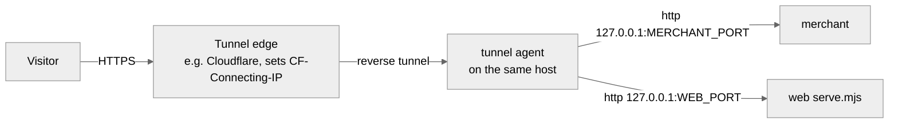

# Self-hosting BOXHAGGLE

BOXHAGGLE is two Node processes: the merchant (The Broker, the x402 paywall and the `/mcp` endpoint) and the web app (the spectator counter). Both bind loopback. A reverse tunnel on the same host is the only public path. Any process manager works: systemd, launchd, pm2, supervisord, a container runtime, or your own supervisor.



An optional local reverse proxy can sit between the tunnel agent and the two services, as long as it also listens on loopback and passes `CF-Connecting-IP` through unchanged (see Client IP below).

## Requirements

- Node 24 (`.node-version`), npm, git.
- Two public hostnames on a domain your tunnel serves, for example `api.example.com` (merchant) and `play.example.com` (web).
- A Solana or Base wallet you control to receive payments (`PAYTO_SOLANA`, `PAYTO_BASE`).
- A process manager that restarts a crashed process, keeps exactly one merchant instance (state lives in memory) and loads env from a secret store or a `0600` env file, never from the command line.

## Build

One checkout per service keeps a rebuild of one from reinstalling `node_modules` under the other.

```bash
git clone https://github.com/iam25th1/boxhaggle.git boxhaggle-merchant
cd boxhaggle-merchant
npm ci --ignore-scripts
npm run build -w @boxhaggle/core
npm run build -w @boxhaggle/merchant
npm run build:counter -w @boxhaggle/web   # the in-chat counter the merchant serves at ui://boxhaggle/counter
```

```bash
git clone https://github.com/iam25th1/boxhaggle.git boxhaggle-web
cd boxhaggle-web
npm ci --ignore-scripts
npm run build -w @boxhaggle/core
VITE_MERCHANT_URL=https://api.example.com npm run build -w @boxhaggle/web
```

If the build runs with `NODE_ENV=production` already set, `npm ci` skips devDependencies (TypeScript, Vite). Use `npm ci --ignore-scripts --include=dev` there.

## Run

| Service | Command (from its checkout) | Default port | Health |
| --- | --- | --- | --- |
| merchant | `node apps/merchant/dist/index.js` | 8787 | `GET /healthz` |
| web | `node apps/web/serve.mjs` | 8080 | `GET /healthz` |

Point your process manager's health check at `/healthz`. Run one merchant only.

## Environment

Merchant (full list and defaults in `apps/merchant/.env.example`):

| Variable | Value |
| --- | --- |
| `NODE_ENV` | `production` |
| `HOST` | `127.0.0.1` |
| `PORT` | `<MERCHANT_PORT>` |
| `PUBLIC_BASE_URL` | `https://api.example.com` |
| `WEB_ORIGIN` | `https://play.example.com` |
| `MERCHANT_API_KEY` | `<secret, 32+ random characters>` |
| `X402_NETWORKS` | `solana` (or `solana,base`, in preference order) |
| `PAYTO_SOLANA` | `<your Solana receiving wallet>` |
| `PAYTO_BASE` | `<your Base receiving wallet, or empty>` |
| `FACILITATOR_MODE` | `http` |
| `X402_FACILITATOR_URL` | `https://facilitator.payai.network` |
| `X402_FACILITATOR_TOKEN` | `<secret, only if your facilitator needs one>` |
| `TRUST_CF_CONNECTING_IP` | `1` behind a Cloudflare tunnel on the same host, else `0` |
| `TRUST_PROXY` | `0` (never `1` together with the above) |
| `LOG_LEVEL` | `info` |

`OFFER_FEE_ATOMIC`, `SESSION_TTL_MINUTES` and `PAYMENT_TIMEOUT_SECONDS` have sane defaults.

Web (public values, not secrets):

| Variable | Value |
| --- | --- |
| `HOST` | `127.0.0.1` |
| `PORT` | `<WEB_PORT>` |
| `VITE_MERCHANT_URL` | `https://api.example.com` (read at build time) |
| `MERCHANT_ORIGIN` | `https://api.example.com` (CSP `connect-src` at runtime) |
| `WEB_DIST` | `apps/web/dist` |

Generate the merchant key straight into a private file instead of the terminal:

```bash
umask 077
node -e "process.stdout.write(require('crypto').randomBytes(32).toString('base64url'))" > merchant-api-key.txt
```

Give the same value to PayBox (the agent's secret credential and the plugin's brokered `X-Merchant-Key` header) by pasting it from that file, then delete the file once your secret store holds it. When changing env later, compare key names and value lengths before and after; never print values.

## Tunnel

Any reverse tunnel that terminates on the same host works. With Cloudflare, one tunnel for this app alone, its own credentials file, and two ingress rules:

```yaml
tunnel: <TUNNEL_ID>
credentials-file: <path to this tunnel's credentials JSON, mode 0600>
ingress:
  - hostname: api.example.com
    service: http://127.0.0.1:<MERCHANT_PORT>
  - hostname: play.example.com
    service: http://127.0.0.1:<WEB_PORT>
  - service: http_status:404
```

Then `cloudflared tunnel route dns <TUNNEL_NAME> api.example.com` and the same for the web hostname. Single-level subdomains are covered by the free edge certificate.

## Client IP and `CF-Connecting-IP`

Rate limits key on the client IP. Pick one mode:

- **`TRUST_CF_CONNECTING_IP=1`**, only when the merchant's sole public path is a Cloudflare tunnel whose agent runs on the same host. The merchant then reads `CF-Connecting-IP`, but only from a loopback peer and only when it parses as an IP; from any other peer it is ignored and the socket address is the key. The Cloudflare edge sets the header on every tunnelled request and refuses a request that already carries one (403, `error code: 1000`), so a client cannot choose it. A local proxy in between must listen on loopback and forward `CF-Connecting-IP` unchanged; what it does to `X-Forwarded-For` does not matter in this mode. Residual risk: any process on the host can reach the merchant on loopback and pick its own key, so the host is inside the trust boundary.
- **`TRUST_PROXY=1`**, only behind a platform proxy that overwrites `X-Forwarded-For` (the Railway alternate below).
- **Both `0`**, when clients connect directly. Production refuses both set to `1`.

## Security checklist

- **Bind.** Both services listen on `127.0.0.1`. Check from another machine on your network that the ports refuse connections.
- **CORS.** Exactly `WEB_ORIGIN`. Production refuses a non-https value.
- **CSP.** `serve.mjs` sends a strict CSP with `connect-src 'self' <MERCHANT_ORIGIN>` and `Cache-Control: no-transform`, so a CDN that injects analytics scripts leaves the page alone. The merchant sends `default-src 'none'; frame-ancestors 'none'`.
- **Secrets.** `MERCHANT_API_KEY` lives only in your secret store and the merchant's memory. The web bundle carries only the public merchant URL; the counter bundle carries nothing server specific. Logs redact the key and never contain payment headers.
- **Error pages.** If a local proxy answers with its own 502 page while the merchant is down, make sure that page does not name local ports or paths, or let the tunnel edge replace it.
- **Uptime.** In-memory state means a restart drops open sessions. A host that sleeps, or waits at a disk-unlock screen after a reboot, takes both services down until someone acts.

## In-chat counter (`/mcp`)

The merchant serves an MCP endpoint at `<PUBLIC_BASE_URL>/mcp` (streamable HTTP, stateless, JSON responses) with `haggle_start`, `haggle_offer`, `haggle_checkout`, `haggle_reveal` and `haggle_status`, plus the keyless PayBox `use_service` routes `/mcp-pay/offer/:sessionId` and `/mcp-pay/checkout/:sessionId`. It uses the same tunnel route as the rest of the merchant. Add it to Claude as a custom connector with that URL and **No sign-in**; paying also needs the PayBox connector.

## Alternate: Railway

`apps/*/Dockerfile` and `apps/*/railway.json` deploy the same two services on Railway. The Dockerfiles set `HOST=0.0.0.0` because loopback inside a container is unreachable from the platform proxy; set `TRUST_PROXY=1` and `TRUST_CF_CONNECTING_IP=0` there, and keep `numReplicas` at 1.
